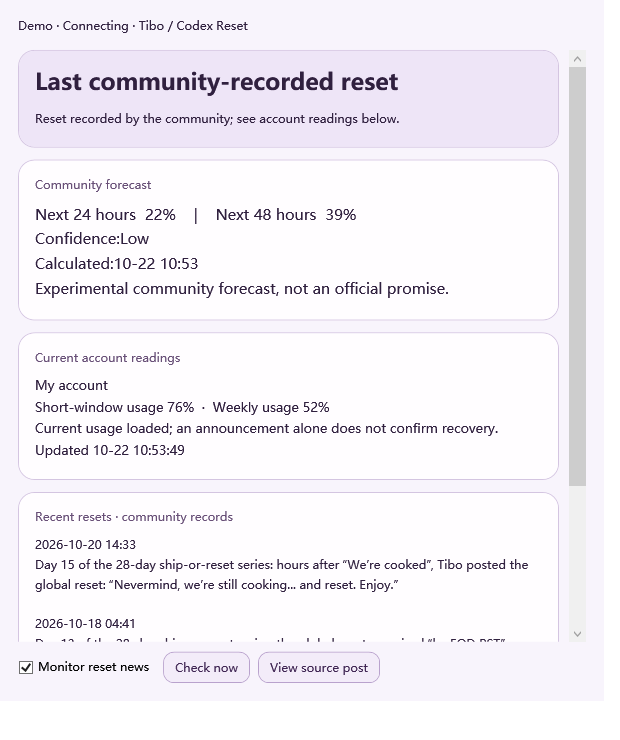

# Lumi · Codex Desktop Companion

**A little desktop company while Codex works.**

[中文](README.md) · [日本語](docs/README.ja.md) · [한국어](docs/README.ko.md)

**Work in progress. This is a source preview, not a standalone public installer.**

Lumi is an independent Windows desktop companion that brings local Codex task progress, public assistant replies, token usage and account quota into a character's speech bubble. It is not an official OpenAI product or a built-in ChatGPT Pet.

## Features

- Task notifications open the matching task; quota notifications open the matching account. Handled messages leave the conversation list.
- Per-turn token estimates use compact units such as `2.37M`; hover for the exact count. Availability depends on verified local task events.
- Hourly/weekly quota, account management and reset-card details live alongside the pet. Account changes and card consumption require explicit confirmation.
- Reset announcements separate community records, experimental 24/48-hour probabilities and actual local account readings. Data attribution: [Codex Reset](https://codex-reset.com/developers).
- Live Chinese, English, Japanese and Korean UI switching, persisted locally. User/project/account text remains in its original language.
- Chibi and full-body candidates, activity-driven states, tray controls and full-screen suspension/recovery. Artwork, motion and long-run stability remain under development.

## Getting started

Read [setup and development](docs/SETUP.md). The repository includes application source and isolated checks. Runtime binaries, proprietary Cubism Core and character/model assets are not bundled; cloning alone does not produce a runnable pet. Developers with a licensed complete asset bundle can assemble a new directory using the provided PowerShell script, without copying private state or credentials.

## Development and privacy

The R10 candidate builds on R9 repairs. Data validation and isolated native/renderer checks do not establish real account-switch, real credit-consumption or long-term reliability across Windows/GPU/Codex versions. See the [roadmap](docs/ROADMAP.md).

Local task data and credentials are not published in this repository. The public reset API receives no account credentials. Normal quota/account operations still contact their relevant services. Read [SECURITY](SECURITY.md) before sharing diagnostic material.

[Report an issue](https://github.com/kianaqZero/Lumi-Gpt/issues) · [Contribute](CONTRIBUTING.md) · [Rights and third-party components](docs/RIGHTS.md)
